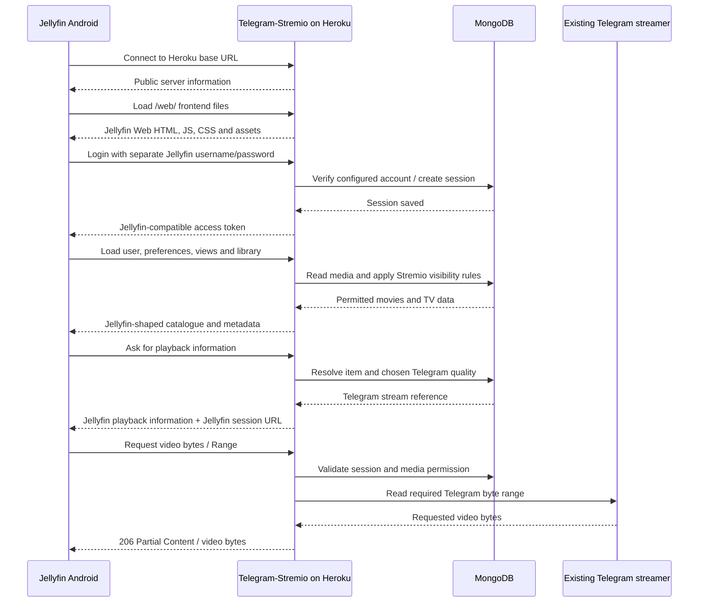

# Telegram-Stremio → Jellyfin Android: Deep Repository Audit

**Audit date:** 11 November 2026  
**Repository reviewed:** User-uploaded `Telegram-Stremio-master` ZIP and the first Jellyfin-compatible modified build (v2)  
**Purpose:** Identify the full set of gaps before doing another implementation pass. This document is a shared project reference, not a deployment guide.

---

# Read this part first

## What we are trying to build

You have Telegram-Stremio running on Heroku. You have the Jellyfin Android app on your phone, but you do **not** have a Jellyfin server installed anywhere.

The goal is to make your existing Heroku application answer the requests that the Jellyfin Android app expects from a Jellyfin server. The app should then be able to:

1. Connect to your existing Heroku address.
2. Sign in with a separate Jellyfin-style username and password.
3. Show Movies and TV Shows from your Telegram-Stremio database.
4. Open a show, choose a season and episode, and play it.
5. Seek forward and backward without downloading the whole file first.

Heroku remains the host. MongoDB remains the database. Telegram remains the video source. We are **not** planning to install a second Jellyfin server.

This is a **Jellyfin-compatible service built inside Telegram-Stremio**, not the official Jellyfin Server. The official Jellyfin Android app may use API behaviour that our service must reproduce. We must prove compatibility with the exact Android app version you have installed.

## What we know from your phone test

Your browser returned this public server information successfully:

```json
{
  "ServerName": "Telegram-Stremio",
  "Version": "10.10.7",
  "ProductName": "Jellyfin Server",
  "OperatingSystem": "Linux",
  "StartupWizardCompleted": true
}
```

That confirms one checkpoint: Heroku can answer the public server-identification request and the returned product name is now correct.

It does **not** prove that login, the Jellyfin interface, library browsing, or playback works. Your Android app showed a loading spinner and then a connection error. That means it got further than the first server-identification check, but a later step failed. The screenshots alone do not identify the exact failed request; we need safe request logging in the next build to identify it.

## My audit conclusion

The previous modified build is a **partial prototype**, not an end-to-end Jellyfin-compatible server yet. Several important pieces are absent, and some existing pieces need correction before we deploy again.

The correct next step is to fix the items in this report as one planned implementation pass, then run a proper test suite before asking you to deploy another ZIP.

---

# 1. What I inspected

I compared the original uploaded repository with the v2 modified repository and inspected the FastAPI entry point, Jellyfin compatibility routes, authentication, database records, streaming route, metadata models, subtitle support, configuration, Docker/Heroku deployment files, and the existing compatibility smoke test.

Relevant files in the modified repository:

| File | What it does | Audit finding |
|---|---|---|
| `Backend/fastapi/main.py` | Starts FastAPI and registers routes | Jellyfin router is registered, but no Jellyfin Web client is mounted under `/web/` |
| `Backend/fastapi/routes/jellyfin_routes.py` | New Jellyfin-like API routes | Useful starting point, but only a subset of the expected API is present |
| `Backend/fastapi/routes/stream_routes.py` | Existing Telegram media streaming | Has real Range/HEAD handling that we should reuse |
| `Backend/fastapi/security/tokens.py` | Validates Telegram-Stremio API tokens | Can be reused internally, but its token must never be sent to Jellyfin Android |
| `Backend/helper/strm_generator.py` | Chooses the token used in `.strm` links | Current fallback can select the first active token; Jellyfin needs a deliberate source-token choice |
| `Backend/fastapi/routes/stremio_routes.py` | Stremio catalogue visibility rules | Contains private/owner/token visibility rules that the Jellyfin catalogue currently does not apply |
| `Backend/helper/modal.py` | Movie, show, episode and Telegram quality data models | Gives us the available metadata and Telegram stream references |
| `Backend/helper/subtitles.py` | Existing subtitle metadata helpers | Potential basis for Jellyfin subtitle support |
| `Dockerfile`, `heroku.yml`, `pyproject.toml`, `uv.lock` | Heroku Docker deployment and dependencies | Can package static web files in the app image; WebSocket support dependency is not currently installed |
| `tools/jellyfin_compat_contract_smoke_test.py` | Current compatibility smoke test | Uses fake database and fake streaming functions; it is not a real Telegram streaming test |

The v2 change set added a Jellyfin route file and configuration, but it did **not** add a `web/` directory, Jellyfin Web files, or a WebSocket implementation.

---

# 2. What is already present

These items exist in code today, but several still need real deployment/client verification.

| Area | Current state | What that means |
|---|---|---|
| Public server identification | Present | `/System/Info/Public` returns a Jellyfin-like identity. Your browser has confirmed this live. |
| Auth endpoint | Present | `POST /Users/AuthenticateByName` checks the configured separate username/password and issues a server-created access token. |
| Session storage | Present | Session token hashes and expiry are stored in MongoDB. |
| User profile | Present | Basic `/Users/Me` and `/Users/{id}` responses exist. |
| Library roots | Present | Two root views are exposed: Movies and TV Shows. |
| Movies | Present | Basic movie details are mapped from MongoDB. |
| TV hierarchy | Present | Series → Seasons → Episodes is represented. |
| Posters/backdrops | Partly present | Basic image URLs are returned through redirects. |
| Playback information | Partly present | A basic media source URL is built for a selected Telegram quality. |
| Telegram stream bridge | Present in code | It calls the existing `/dl` stream handler internally. Real playback has not been proven through this path. |
| Range/HEAD support | Present in existing streamer | The underlying streamer parses HTTP Range requests and can return partial content. The Jellyfin bridge still needs end-to-end verification. |
| Playback progress | Basic version present | Progress/stopped events are stored, but the client-facing item state is incomplete. |
| Logout | Present | The current Jellyfin session can be deleted/revoked. |

**Important:** “Present” means that a code path exists. It does not mean that the official Jellyfin Android app has successfully used it.

---

# 3. Missing pieces and defects

## A. Critical: Jellyfin Web interface files are missing

**Priority: Blocker**

The repository does not contain the Jellyfin Web frontend files. The Android app uses a WebView for its main interface and requests files such as:

```text
/web/index.html
/web/main.jellyfin.bundle.js
/web/node_modules.jellyfin-apiclient.bundle.js
/web/serviceworker.js
```

Our modified app has no `/web/` static-file mount and no matching web bundle. It currently has admin templates under `Backend/fastapi/templates/`, but those are Telegram-Stremio admin pages, not the Jellyfin interface.

### What we need to do

- Add the official Jellyfin Web frontend files built for the API compatibility version we expose (the current compatibility response says `10.10.7`).
- Serve those files under `/web/` with correct MIME types, cache headers and fallback behaviour.
- Include the index page, JavaScript bundles, CSS, language files, icons/fonts and service worker where provided by that release.
- Keep the Jellyfin Web license and notices with the bundled files.
- Pin the frontend version; do not silently pull the newest frontend during every Heroku build.
- Measure the added image/slug size and verify Heroku can build and start with it.

We should not download the frontend dynamically at application startup. It should be part of the deployable source/image so the app does not rely on a third-party CDN being available at runtime.

## B. Critical: Android startup API coverage is incomplete

**Priority: Blocker for a reliable connection**

The current route file implements some core calls, but known Jellyfin Android/Web client logs show additional startup requests. The exact calls vary by app and web-client version, so the next build must record the real requests from your app and compare them with the supported list.

| Endpoint / feature | Current state | Planned action |
|---|---|---|
| `GET /System/Info/Public` | Implemented | Keep and test |
| `GET /System/Info` | Implemented | Complete required response fields |
| `GET /Users/Public` | Implemented | Keep and test |
| `POST /Users/AuthenticateByName` | Implemented | Test with actual Android login request |
| `GET /Users/Me` and `GET /Users/{id}` | Implemented | Complete user DTO where needed |
| `GET /Sessions/Capabilities/Full` / client capability registration | Missing | Add the method and response expected by the target client |
| `GET /DisplayPreferences/usersettings` | Missing | Add default user display preferences |
| `GET/POST /DisplayPreferences/{id}` | Missing | Add safe read/update support or a documented read-only response |
| `GET /Sessions` | Missing | Return valid session list (empty except current session if appropriate) |
| `GET /LiveTv/Programs/Recommended` | Missing | Return a valid empty result; we do not offer Live TV |
| `GET /Shows/NextUp` | Missing | Return next-up episodes or a valid empty result initially |
| `/socket` WebSocket | Missing | Add WebSocket handshake and minimal Jellyfin socket message handling |
| `GET /System/Endpoint` | Missing | Check whether the installed client calls it; implement if required |
| `GET /Playback/BitrateTest` | Missing | Determine whether the target client calls it; if required, implement a bounded test response |
| `/QuickConnect/Enabled` and `/QuickConnect/Status` | Missing | Explicitly report disabled for MVP, unless the app requires another exact response |
| Other unrecognised startup calls | Unknown | Safe request logging must reveal them during the next phone test |

A public Jellyfin Android WebView startup log shows the Web bundles and calls such as `/System/Info`, `/Sessions/Capabilities/Full`, `/socket`, `/Users/{id}`, and `/DisplayPreferences/usersettings`. Other Jellyfin Android logs show `/LiveTv/Programs/Recommended`, resume/latest library queries and bitrate tests. These are examples from published logs, not a guarantee that every version makes exactly the same calls.

### WebSocket dependency issue

The project currently depends on plain `uvicorn` and does not include a WebSocket protocol package such as `websockets` or `wsproto`. Starlette can define a WebSocket route, but the ASGI server also needs a WebSocket implementation. We must add and test that dependency before implementing `/socket`.

The first WebSocket milestone is only to make the client handshake successfully and safely handle keep-alive messages. Full server notifications and remote-control events are not part of the first release.

## C. Library responses exist, but important behaviour is incomplete

**Priority: High**

The current code can return Movies and TV Shows and represent seasons/episodes. However:

1. `Items/Latest` ignores `ParentId`; the client can ask for latest items inside one library, but the code currently returns all movies and shows.
2. `Items/Resume` ignores `MediaTypes`; it may return video items even when the client asks for audio or books. We should filter to supported video content and return an empty list for unsupported media types.
3. Most item responses do not include `UserData` (played/favourite/resume state). Only the resume endpoint adds a small `UserData` object.
4. Search, sorting, filters and requested fields are only partly handled or ignored.
5. The top-level catalogue is loaded by scanning every movie and TV record into application memory. That may become slow and memory-heavy as the database grows.
6. The cache is process-local. It is acceptable for a small first release only after we set a clear TTL and invalidation strategy.
7. Some metadata fields need consistent types and fallbacks (`CommunityRating`, `DateCreated`, `RunTimeTicks`, episode runtime, sort name, child counts and image tags).
8. Stable item IDs should be versioned and protected against tampering. The current ID is base64-encoded JSON, which is readable and can be modified by a client.

### What we need to do

- Define the exact read-only library behaviour we support: Movies, Series, Seasons and Episodes.
- Add the item fields expected by the Web client and Android player.
- Make `ParentId`, item type, pagination and sorting behave correctly.
- Include per-user watched/resume state consistently.
- Use stable, signed or otherwise tamper-resistant item IDs.
- Avoid full unbounded database scans on every cache miss; use database pagination/projections and indexes where practical.
- Add integration fixtures using realistic movie/TV documents from this repository's data model.

## D. Important security defect: current Jellyfin library scan bypasses content visibility

**Priority: Blocker before exposing the service to other people**

Telegram-Stremio already supports content visibility such as:

- Public content.
- Content allowed only for selected API tokens.
- Owner-only content.
- Content restricted to a specific custom catalogue.

The existing Stremio code enforces these rules using helpers such as `_visibility_query`, `_token_can_view` and `_not_exclusive_clause`.

The new Jellyfin catalogue scan currently calls the movie and TV collections with an empty query and does not load the visibility fields in its projection. That means it can list content that should be hidden from the selected access token. The existing Jellyfin account is not currently mapped to the proper Telegram-Stremio access permissions.

### What we need to do

- Decide which existing Telegram-Stremio API token is the source identity for Jellyfin access.
- Prefer an explicit configured source token or an already-selected STRM default token; do not silently use an arbitrary first token for the final implementation.
- Validate that token and apply the same visibility rules as Stremio before showing an item.
- Include the required visibility fields in MongoDB reads.
- Apply the same permission check again when a user opens an item and when playback starts, not just when the list is built.
- Exclude exclusive catalogue items from the general Movies/TV Shows views unless the design deliberately adds those catalogues as separate Jellyfin views.
- Ensure cache entries cannot mix permission contexts.

This is a correctness and privacy issue, not just a user-interface improvement.

## E. Authentication is a useful start, but needs hardening and a real-client test

**Priority: High**

Current approach:

- One separate username/password comes from Heroku Config Vars.
- Successful login creates a random Jellyfin session token.
- Only a hash of that token is stored in MongoDB.
- The session has an expiry date and can be deleted at logout.

Items to correct or verify:

1. Test the actual login body sent by your installed Jellyfin Android version; do not assume a simulated request matches it.
2. Verify the expected `Authorization` header formats and token query parameters used by the app and native player.
3. Rate limiting is currently held in process memory. It resets on dyno restart and is not shared across multiple dynos. Use persistent/shared throttling or document the one-dyno MVP limit.
4. Add an endpoint/session list response consistent with what the client expects.
5. Ensure a logged-out or expired session cannot open a previously copied stream URL.
6. Keep tokens out of logs and error messages. Query strings can contain the Jellyfin playback token, so request logging must redact query strings.
7. Keep the Telegram-Stremio source API token separate from the Jellyfin client token at every step.

Quick Connect should remain disabled in the first implementation unless the normal username/password login is proven and we deliberately decide to add pairing later.

## F. Playback response and Telegram bridge are not proven end to end

**Priority: Blocker for the main goal**

The modified route calls the existing Telegram stream handler, which is the correct direction: we should reuse the established Telegram streamer instead of writing another downloader.

However, current playback information is minimal:

- It sends an empty `MediaStreams` array.
- It does not provide reliable codec, audio, subtitle or video-track information.
- It marks direct play/direct stream as supported without first proving that the selected Telegram file is compatible with the phone's player.
- The playback URL is built from `request.base_url`. Behind Heroku's HTTPS router, we need to ensure that generated playback URLs always use the public HTTPS base URL configured in Telegram-Stremio.
- The selected quality is based on a simple quality string ordering. It should be checked against real saved quality values and configured preferences.
- There is no verified behaviour yet for multiple Telegram file parts, deleted Telegram messages, unavailable bot sessions, or expired source tokens through Jellyfin playback.

### What we need to do

- Reuse the existing Telegram stream handler and its byte-range implementation.
- Generate the public playback URL from the configured public base URL, not an untrusted request scheme.
- Ensure the Jellyfin token is the only client-facing auth token; resolve and validate the separate Telegram source token inside the backend.
- Return the playback metadata that the Jellyfin player needs. Do not claim transcoding support; this project will begin with direct play/direct stream only.
- Test GET, HEAD, `Range: bytes=0-...`, seeking to a later range, client disconnect, and a large file.
- Confirm actual response status and headers: `206 Partial Content`, `Content-Range`, `Content-Length`, `Accept-Ranges`, content type and filename.
- Test both a normal Telegram file and a split/virtual file if those are part of the repository's regular library.
- If the phone cannot play a source codec/container directly, report it as unsupported. Do not pretend that Heroku is transcoding it.

## G. Subtitles and track information need a planned boundary

**Priority: Medium for first playback; high for feature completeness**

The repository already has subtitle helpers and Stremio subtitle routes. The Jellyfin compatibility API does not currently expose a corresponding subtitle list/stream contract.

For the first successful playback milestone, we can explicitly support no external subtitle tracks, provided the video still plays. After that we can map available subtitle records to Jellyfin subtitle streams and implement subtitle delivery.

We should not tell the player that subtitle streams exist until there is a working endpoint and correct metadata.

## H. WebSocket and session behaviour

**Priority: High for normal app experience**

The Jellyfin Web client uses a `/socket` connection for live server messages. A normal JSON API route is not a replacement for a WebSocket upgrade.

We need to:

- Add the required Python WebSocket dependency.
- Implement `/socket` with proper token/device validation.
- Support keep-alive messages and clean disconnects.
- Make sure Heroku's router accepts the WebSocket connection and the process doesn't close it immediately.
- Return an empty/valid session list where the app asks for active sessions.

Full remote-control, server notifications and multi-session event broadcasting can be deferred.

## I. Diagnostics are missing

**Priority: Blocker for reliable troubleshooting**

The current compatibility routes do not provide a focused, safe diagnostic trail for Jellyfin requests. When Android says “Connection cannot be established”, we need to know which exact request failed.

Add a small logging layer for Jellyfin paths that records:

- HTTP method.
- Path (without query string).
- Response status.
- Duration.
- Whether the request was authenticated (never the token itself).

Never log passwords, tokens, `api_key`, Telegram IDs, or full query strings. Also log exceptions with a safe request correlation ID.

Add a diagnostic endpoint for the admin only that reports whether compatibility is enabled, MongoDB is connected, a Telegram source token is configured/valid, and the web asset bundle is present. It must not reveal credentials.

## J. The current tests give more confidence than they really should

**Priority: Blocker before another deployment**

I ran these local checks against v2:

```text
python -m py_compile ...
python tools/jellyfin_compat_contract_smoke_test.py
```

They pass. The smoke test prints 11 PASS checks.

But the test deliberately replaces MongoDB and the Telegram streamer with fake objects. Its fake stream handler simply checks that a Range header was passed and returns a normal `200` response. It does not prove that Telegram returned the requested bytes, that the real handler produced `206 Partial Content`, or that Android can play the result.

So these are **unit/contract smoke checks only**, not full end-to-end tests.

### Tests required for the next build

1. Python compilation and import/startup tests.
2. Route tests for every required startup endpoint.
3. Authentication tests: correct/incorrect password, token reuse, logout, expiry, revoked token and device/session isolation.
4. Library tests with real-shaped MongoDB records and visibility restrictions.
5. Playback-info schema tests.
6. Real streaming-route tests against the project's actual streamer or controlled Telegram test media; verify 206 and seek behaviour.
7. Web asset checks: `/web/index.html`, main JS bundle, CSS, translations and service worker return correct content types and status codes.
8. WebSocket handshake and keep-alive test.
9. Heroku-like reverse-proxy test to ensure URLs are HTTPS.
10. A request-sequence test based on the actual Jellyfin Android app version you use.

---

# 4. Expected request flow after the fix

This is the simplified flow we are going to implement. The app may make additional calls; our diagnostics will reveal those.



---

# 5. Recommended implementation order

We should not add all endpoints randomly. Implement in this order and test each group before moving on.

| Phase | Work | What must pass before moving on |
|---|---|---|
| 0 | Freeze target client version; add safe request logging; capture current failed request sequence | We know what your Android app is requesting and which request currently fails |
| 1 | Bundle matching Jellyfin Web files and serve `/web/` | Web index, JavaScript, CSS and static assets load correctly |
| 2 | Add missing startup API calls, WebSocket dependency and `/socket` | Android gets through server connection and reaches a login screen |
| 3 | Verify login, user DTO, display preferences, sessions and token revocation | Android logs in and stays signed in after closing/reopening the app |
| 4 | Correct library behaviour and apply Stremio visibility rules | Movies and TV Shows display without restricted content leaking |
| 5 | Correct playback metadata and bridge to Telegram streamer | A movie and an episode start playing from Telegram |
| 6 | Verify Range/seek, resume state, quality selection and error handling | Seeking works and progress is saved reliably |
| 7 | Optional subtitles, Quick Connect, favourites and extra polish | Only after core browsing and playback are stable |

---

# 6. What the next build must include

Before I give you another ZIP to deploy, I will require this checklist to be satisfied locally:

- [ ] Correct Jellyfin public server identity.
- [ ] Compatible Jellyfin Web frontend files served at `/web/`.
- [ ] No runtime dependency on an external web CDN.
- [ ] All startup endpoints required by the target Android app version implemented or safely handled.
- [ ] WebSocket support installed and `/socket` handshake tested.
- [ ] Separate Jellyfin-compatible login and token lifecycle.
- [ ] Telegram-Stremio source token kept private and explicitly selected.
- [ ] Existing visibility and exclusive-catalogue rules applied to the Jellyfin library and playback.
- [ ] Movies, TV Shows, Seasons and Episodes mapped correctly.
- [ ] UserData, latest, resume, pagination and ParentId behaviours corrected.
- [ ] Playback URL always uses the public HTTPS base URL.
- [ ] Real Telegram streaming is verified for GET, HEAD and byte ranges.
- [ ] Playback information does not falsely advertise transcoding or missing streams.
- [ ] Safe request diagnostics identify unknown or failing Android requests.
- [ ] Unit tests, route tests, static asset tests, WebSocket tests and stream tests pass.
- [ ] Deployment guide tells you exactly which Heroku variables are needed and what URLs to check.
- [ ] Phone test instructions are written in simple step-by-step language.

Only after these checks pass will I label the next build **ready for your deployment test**. The final proof still has to come from the real Heroku deployment and your Android phone.

---

# 7. What you will do when we are ready

You should not need to understand Python, Jellyfin APIs or MongoDB.

When implementation and local tests are complete, I will give you:

1. One complete ZIP of the modified repository.
2. A short list of Heroku Config Vars to add or update.
3. Exact GitHub/Heroku deployment steps.
4. A small set of browser URLs to open and screenshots to send back.
5. A phone test checklist: connect → sign in → open Movies → open a show → play → seek.

We will not ask you to keep changing the URL, ports or tokens to guess at problems.

---

# 8. Important limitation to keep in mind

A full official Jellyfin Server is a large application. We are deliberately building only the Jellyfin-compatible behaviour needed for this use case: one user, read-only Movies/TV library, direct Telegram streaming, and basic playback progress.

The first target is **reliable Jellyfin Android browsing and direct playback**, not every Jellyfin feature. Server administration, transcoding, Live TV, plugins, media scanning, remote control, music/books and advanced subtitle management are out of scope unless we later decide they are necessary.

Heroku will still be responsible for proxying video bytes from Telegram to your phone. This avoids another media-storage server, but it does mean streaming consumes Heroku dyno/network capacity and must be tested for long playback sessions.

---

# 9. References used for the audit

These references show real Jellyfin client behaviour and the official Web frontend release source. They are examples used to build the compatibility checklist; they are not a substitute for capturing requests from the exact app installed on your phone.

- [Jellyfin Android issue #1082 — WebView logs requesting `/web/main.jellyfin.bundle.js` and calling library APIs](https://github.com/jellyfin/jellyfin-android/issues/1082)
- [Jellyfin server issue #11089 — Web client logs for `/Sessions/Capabilities/Full`, `/socket`, user and display-preference requests](https://github.com/jellyfin/jellyfin/issues/11089)
- [Jellyfin Android TV issue #4572 — example startup calls for resume, latest, views and Live TV recommendations](https://github.com/jellyfin/jellyfin-androidtv/issues/4572)
- [Official Jellyfin Web releases](https://github.com/jellyfin/jellyfin-web/releases)
- [Official Jellyfin networking documentation](https://jellyfin.org/docs/general/post-install/networking/)

